# 3D Improved U-Net for Prostate MRI Segmentation (HipMRI)

COMP3710 Pattern Recognition report — Project 2.2 (Segmentation), 3D Improved U-Net

Student: **Nur Alya Najma Binti Mohd Zuhar**

Student ID: **49429235**

---

## 1. Overview

**Problem:** In prostate radiotherapy planning, the prostate clinical target volume must be outlined to millimetre precision while sparing nearby organs at risk. Manual contouring is slow, so an automated drafting assistant could help a specialist who then reviews and corrects the proposal. A single global Dice score can hide dangerous local errors. A model may do well on the central slices and still fail at the two ends of the gland or leak into the rectal wall or bladder. This project builds a 3D segmentation model for the HipMRI pelvic MRI volumes and investigates whether 3D volumetric context and a more advanced architecture actually reduce those boundary failures compared with a standard 3D U-Net and at what computational cost.

**How it works:** The model that used is a 3D Improved U-Net. The encoder has five levels which each level after the first begins with a stride-2 convolution and contains a residual context module. The decoder upsamples and concatenates the matching encoder features and fuses them in a localisation module. Deep supervision adds segmentation outputs from the three highest-resolution decoder levels. They are upsampled and summed into the final prediction and the auxiliary outputs also receive loss. Training uses a soft Dice plus cross-entropy loss because the prostate is a small fraction of each volume.

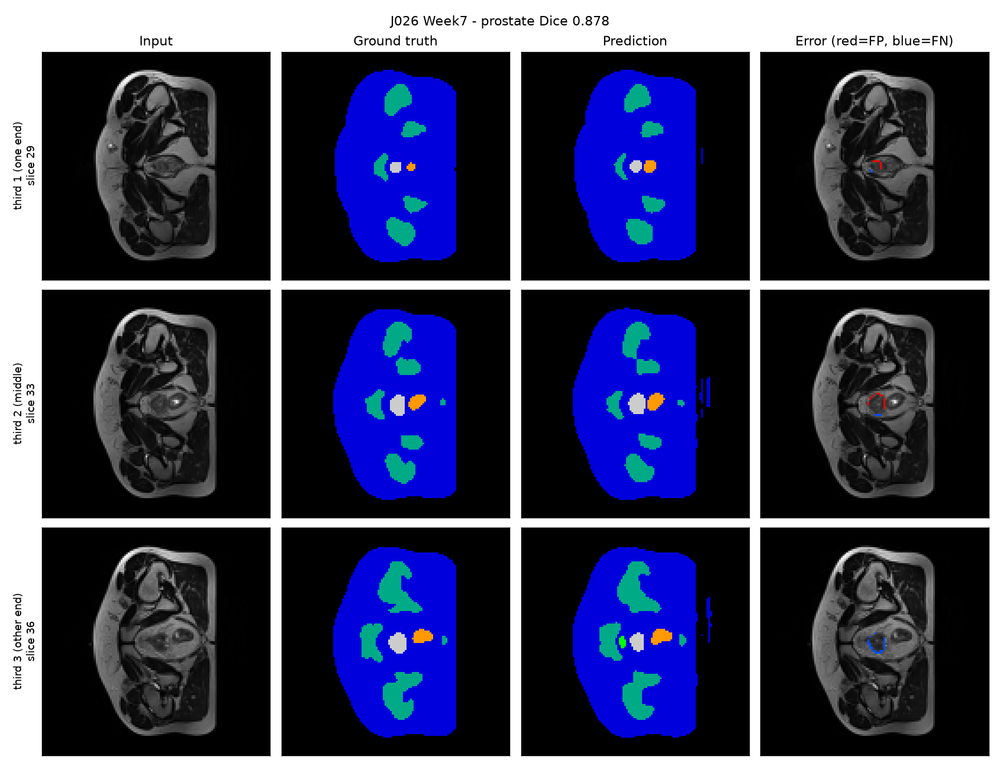
*Example output of the Improved 3D U-Net on test volume J026_Week7: input, ground truth, prediction and error overlay for three slices along the gland (red = false positive, blue = false negative for the prostate).*

---

## 2. Feasibility review


**1\. User Need, Scope & Acceptance Criteria**

**Intended User**: Clinical radiotherapy planning teams, medical physicists and radiation oncologists. **Prototype Purpose**: An automated annotation assistant designed to propose high-precision volumetric contours of the prostate clinical target volume (CTV) on 3D MRIs. So it gonna reducing manual contouring time and minimizing boundary leakage into adjacent critical Organs at Risk (rectal mucosa, bladder wall). **Testable Acceptance Criteria:** Achieve a Sørensen-Dice Similarity Coefficient (DSC) ≥0.70 on the held-out test split for the prostate label. Strictly eliminate slice-transition jaggedness by maintaining 3D volumetric spatial continuity across superior (base) and inferior (apex) slices. Complete inference for a full 3D volume in under 5.0 seconds on Rangpur cluster GPU resources. Maintain a peak GPU VRAM consumption under 16 GB during training with a batch size of 2\.

 

**2\. Model Choice & Course Concepts**

**Dataset Configuration:** Utilizing the 3D HipMRI study dataset located on the Rangpur HPC (/home/groups/comp3710/HipMRI\_Study\_open), containing semantic 3D MRI volumes and expert-annotated ground-truth masks. **Model Architecture:** 3D Improved U-Net featuring 3D volumetric convolutions, 3D residual units to promote deep gradient flow and deep supervision heads at multiple decoder resolutions. **Course & Literature Grounding:** Grounded in biomedical segmentation principles extending 2D U-Net contexts into full 3D volumetric processing to capture continuous anatomical geometry across slices.

 

**3\. Preliminary Feasibility Evidence**

**Data Audit & Hygiene**: Nifti volume loading routines were tested and verifying pre-allocated 5D array structures as outlined in Appendix B. Strict patient-level splitting has been implemented to prevent cross-patient data leakage. **Baseline Smoke Test:** A preliminary smoke test executed on the Rangpur HPC cluster confirmed stable gradient propagation and forward-backward pass execution using a combined Binary Cross-Entropy and 3D Sørensen-Dice loss function.

 

**4\. Risks, Budget & Fallback**

**Key Technical Risks:** High GPU memory footprint inherent to 3D volumetric convolutions leading to out-of-memory (OOM) errors on large volumes. **Computing Budget:** Allocated for execution on the Rangpur HPC cluster using interactive GPU sessions for debugging and Slurm batch scripts for full 30–40 epoch training runs. **Next Planned Experiment**: Execute full training across all patient folds and evaluate boundary leakage around the prostate base and apex slices. **Fallback Strategy**: If 3D VRAM limits or training convergence issues arise, scale back architecture parameters or pivot to a 2D Improved U-Net on slice-wise data while retaining baseline comparison components.

---

## 3. Dependencies and reproducibility

- Python 3.11 
- PyTorch 
- nibabel  
- matplotlib  
- numpy
- scipy 
- Run on Rangpur, A100 GPU, TODO partition and job settings.
- Random seed: 42 (`--seed`).

```bash
# Improved 3D U-Net (creates the split)
python train.py --data-root /home/groups/comp3710/HipMRI_Study_open \
    --model improved --out-dir runs/improved

# 3D U-Net baseline on the SAME split
python train.py --data-root /home/groups/comp3710/HipMRI_Study_open \
    --model baseline --out-dir runs/baseline --split-file runs/improved/splits.json

# Failure-case figures and comparison tables
python predict.py --checkpoint runs/improved/best.pt --split-file runs/improved/splits.json --out-dir predictions/improved

python predict.py --checkpoint runs/baseline/best.pt --split-file runs/improved/splits.json --out-dir predictions/baseline

python compare.py --improved runs/improved/test_results.json --baseline runs/baseline/test_results.json --out-dir comparison
```
All other settings are the defaults of `train.py`: learning rate 5e-4, batch size 1, target size 128×128×64, 16 base channels (the parameter counts in section 6.4 correspond to 16 base channels), dropout 0.3, 100 epochs, seed 42.

**Files**

| File | Purpose |
|---|---|
| `modules.py` | Improved 3D U-Net and baseline 3D U-Net (PyTorch only) |
| `dataset.py` | NIfTI loading, patient-level split, normalisation, resizing, augmentation |
| `utils.py` | Dice+CE loss, Dice/IoU, HD95/ASD, Dice by position along the gland |
| `train.py` | Training, validation, testing, resource profiling, loss curves |
| `predict.py` | Inference on the test split and failure-case figures |
| `compare.py` | Side-by-side tables and charts for the two models |

---

## 4. Data and preprocessing

**Data:** Downsampled HipMRI 3D MR volumes with segmentation labels like background, body, bone, bladder, rectum and prostate with 211 volumes from 38 patients and some patients with several weekly scans.

**Preprocessing:**
- Intensity z-score normalisation per volume.
- Resizing to 128 × 128 × 64 voxels (trilinear for images and nearest-neighbour for labels so label values stay valid). All reported Dice and distance values are computed on this resized grid.
- Labels are stored as class indices which is one-hot encoding happens inside the Dice loss.
- Augmentation: random flip along the left–right axis (the first volume axis, displayed vertically in the figures in section 7), intensity scale and shift and Gaussian noise.

**Splits:** The split is by patient, so every volume of a patient is in exactly one split. This avoids leakage: scans of the same patient taken in different weeks look very similar, and splitting by volume would let the model see the test patient's anatomy during training. `check_no_leakage()` verifies it.

| Split | Patients | Volumes |
|---|---|---|
| Train | 26 | 136 |
| Validation | 6 | 48 |
| Test | 6 | 27 |

The split is by patient (about 70/15/15) so the volume counts are uneven: patients have different numbers of scans. The validation set picks the best checkpoint; the test set is used once at the end. The test set contains patients J026, T014 and V027 with 8 volumes each (24 of 27 volumes) and K008, S028, T009 with one each so per-volume results are dominated by three patients.

---

## 5. Training setup

- Loss: Soft Dice + cross-entropy; deep-supervision weights 1, 0.5, 0.25 (normalised).
- Optimiser: AdamW, learning rate 5e-4, weight decay 1e-5, cosine annealing; batch size 1; 100 epochs; mixed precision.
- Model selection: epoch with the highest validation prostate Dice (epoch 68 for the improved model).
- Baseline: standard 3D U-Net with max-pooling, transposed-convolution upsampling and batch normalisation, trained with the same split, loss, optimiser and epochs. Batch normalisation with batch size 1 is a weakness of the baseline and it may have affected its results which mean no ablation was run to test this.

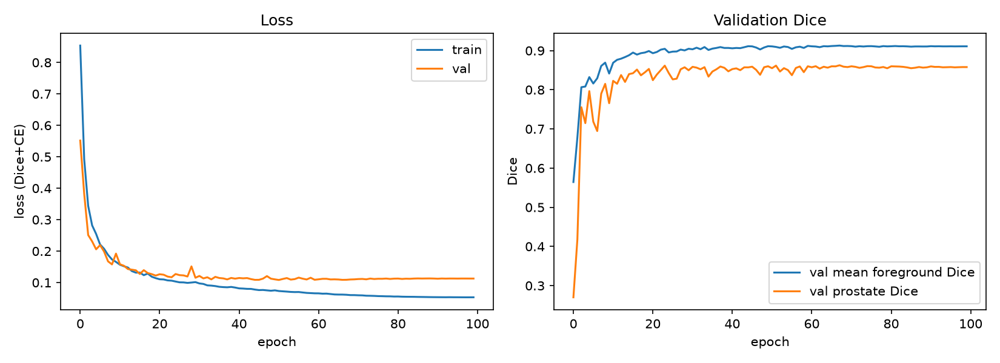

Training loss falls from 0.85 to 0.053. Validation loss stops improving around epoch 30–40 and ends at 0.113 while validation Dice stays flat rather than falling which indicates some overfitting without a loss in Dice. The best validation prostate Dice (0.863) was at epoch 68.

---

## 6. Results: Improved 3D U-Net vs. 3D U-Net baseline

*All values on the held-out test split (6 patients, 27 volumes). HD95 and ASD are in voxels of the 128×128×64 grid. The baseline columns filled from `comparison/tables.md`.*

### 6.1 Per-class accuracy and boundary precision

| Class | Dice (Improved) | Dice (Baseline) | IoU (Improved) | IoU (Baseline) | HD95 (Improved) | HD95 (Baseline) | ASD (Improved) | ASD (Baseline) |
|---|---|---|---|---|---|---|---|---|
| Body | 0.988 | 0.981 | 0.976 | 0.962 | 1.00 | 1.81 | 0.21 | 0.42 |
| Bone | 0.923 | 0.910 | 0.857 | 0.836 | 1.14 | 1.24 | 0.44 | 0.52 |
| Bladder | 0.949 | 0.934 | 0.905 | 0.880 | 1.19 | 3.06 | 0.36 | 0.55 |
| Rectum | 0.857 | 0.811 | 0.754 | 0.687 | 2.22 | 2.71 | 0.58 | 0.83 |
| **Prostate** | **0.853** | **0.846** | **0.746** | **0.735** | **1.47** | **1.42** | **0.56** | **0.59** |

**Mean foreground Dice (Improved)**: 0.914. Both models exceed the course target of 0.70 for the prostate. Neither model missed a structure entirely in any test volume (0 of 27 for every class). The improved model scores higher on every class except prostate HD95 where the two are essentially tied (1.47 vs 1.42 voxels). The largest gains are for the rectum (Dice +0.046, IoU +0.067) and for bladder boundary distance (HD95 1.19 vs 3.06 voxels) while the prostate Dice difference is small (+0.007).

### 6.2 Prostate Dice by position along the gland

The extent of the ground-truth prostate along the slice axis is split into three equal parts.

| Position | Improved | Baseline | Difference |
|---|---|---|---|
| Third 1 (smallest cross-sections; probably apex) | 0.787 | 0.732 | +0.055 |
| Third 2 (middle) | 0.909 | 0.895 | +0.014 |
| Third 3 (next to the bladder; probably base) | 0.847 | 0.839 | +0.008 |

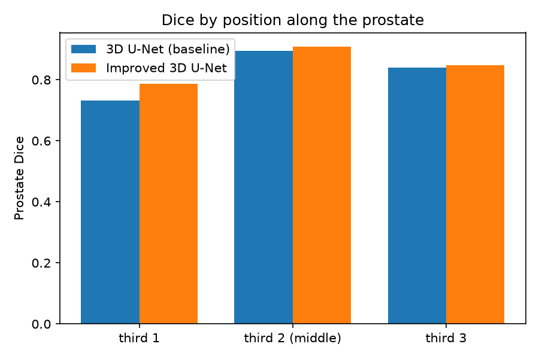

Both models are best in the middle of the gland and weakest at one end. The improved model's gain over the baseline is largest at that weak end (+0.055, against +0.014 in the middle and +0.008 at the other end) but it does not remove the weakness which is the end-of-gland Dice is still 0.787 against 0.909 in the middle (a spread of 0.12; 0.16 for the baseline). From the figures in section 7, third 1 appears to be the apex end (the prostate cross-section is very small) and third 3 the base end (bladder-coloured false positives appear beside the prostate there). This assignment rests on visual inspection of a few volumes.

### 6.3 Paired comparison over test volumes

Over the 27 test volumes the mean prostate Dice difference (improved minus baseline) is +0.007. The improved model is better on 16 volumes and worse on 11 (Wilcoxon signed-rank p = 0.077). The overall prostate Dice difference is therefore small and not clearly separable from noise. Volumes from the same patient are not independent (24 of the 27 test volumes come from three patients) and each model is a single training run so even this p-value is only indicative.

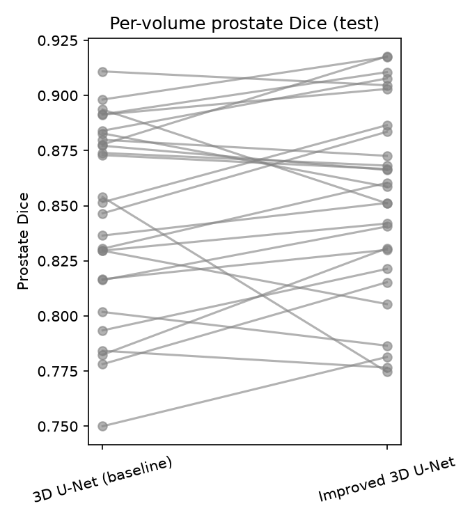

### 6.4 Computational cost

| Metric | Improved 3D U-Net | 3D U-Net baseline |
|---|---|---|
| Trainable parameters | 8,280,066 | 5,646,470 |
| Training peak VRAM | 1.14 GB | 0.70 GB |
| Inference peak VRAM | 0.76 GB | 0.66 GB |
| Inference time (forward pass, per volume) | 0.022 s | 0.017 s |
| Best epoch (of 100) | 68 | 33 |

The improved model has about 1.5× the parameters, 1.6× the training VRAM and 1.3× the inference time of the baseline. Both models train in about 1 GB of GPU memory at this resolution, so memory was not a limiting factor. These ratios are far from the "5–10× the GPU memory and training time" mentioned in the brief although that figure was framed for 3D versus 2D which this project does not compare. Total training time was not measured for this report.

---

## 7. Failure-case analysis

Example figures come from `predict.py`. For each case, three slices (the middle of each third of the ground-truth prostate) with input, ground truth, prediction and an error overlay (red = false positive, blue = false negative). The cases were chosen from the lowest-scoring test volumes.

These volumes were chosen from the improved model's lowest-scoring test volumes (so the baseline is not at its worst on them; see the selection note below). The observations below are taken from the figures in `results/failure_cases/`:

| Case | What the numbers show | Failure type and likely trigger |
|---|---|---|
| `J026_Week1` | Improved 0.775 vs baseline 0.854. In the middle and end slices the improved model's prostate extends towards the rectum along a straight edge (red false-positive band); the baseline shows only a thin sliver. | Over-contouring at the prostate–rectum interface, the clinically harmful direction. |
| `T014_Week2` | Improved 0.781 vs baseline 0.750. At the end slice the ground-truth prostate is a tiny dot and both models predict no prostate there (blue false negative); elsewhere only thin one-voxel rims. | Very small cross-section at the end of the gland (only a few voxels wide on the 128×128×64 grid), so partial volume and resolution dominate. |
| `T014_Week1` | Improved 0.787 vs baseline 0.802. Same pattern: the small prostate at the end slice almost disappears in both models; thin red line on the rectum side at the other end. | Same small-cross-section problem as above. |
| `J026_Week7` | Prostate 0.918 vs 0.878, but improved rectum Dice only 0.647 (HD95 7.3 voxels): at the first-third slice the predicted rectum is larger than the ground truth. Small false positives in the label I read as bladder near the prostate at the other end. The baseline also produces stray body-label fragments at the image edge. | Rectum over-segmentation where its ground-truth cross-section is tiny; baseline: disconnected artefacts near the field-of-view edge. |
| `J026_Week6` | Improved 0.859 vs baseline 0.883; improved rectum HD95 8.5 voxels and lowest bladder Dice (0.832). Red ring around the prostate at the end slice (over-segmentation), plus a small bladder-coloured false positive beside the prostate in both models. | Over-contouring near the bladder end of the gland. |

Each case is shown for the improved model and then for the baseline on the same volume and the table gives the observed failure and its most likely cause.

**J026_Week1** — improved (up) and baseline (down) predictions

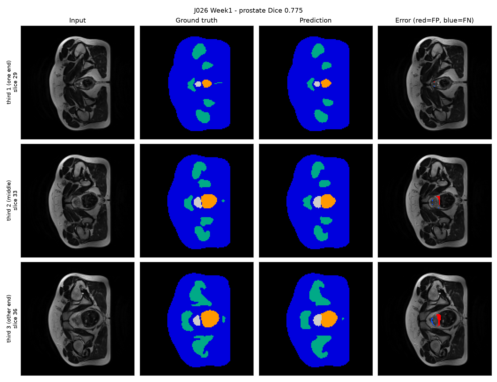
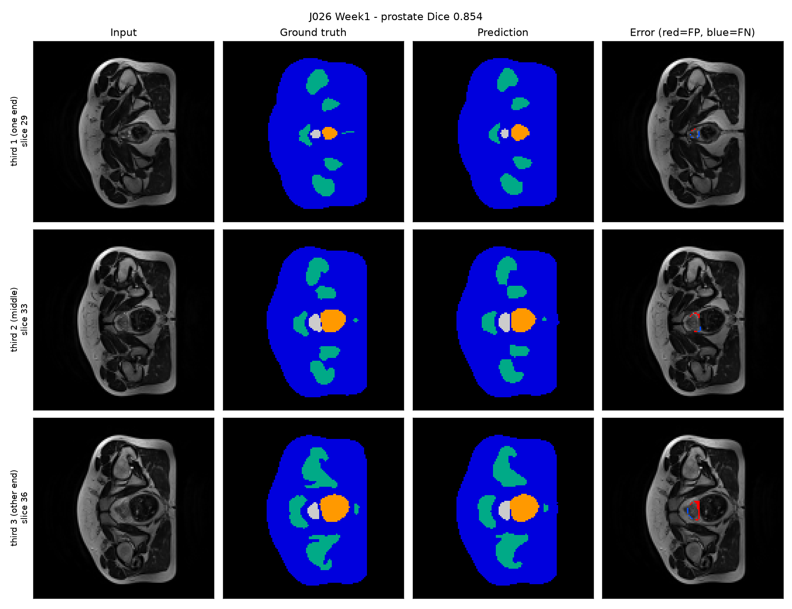


**T014_Week1** — improved (up) and baseline (down) predictions

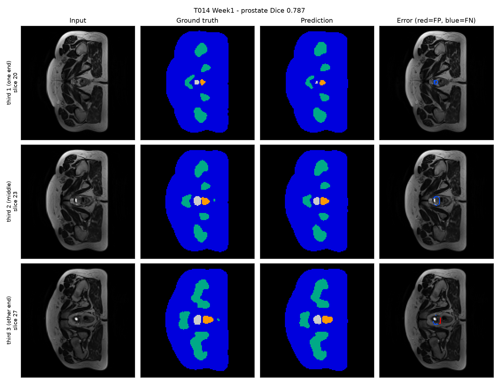
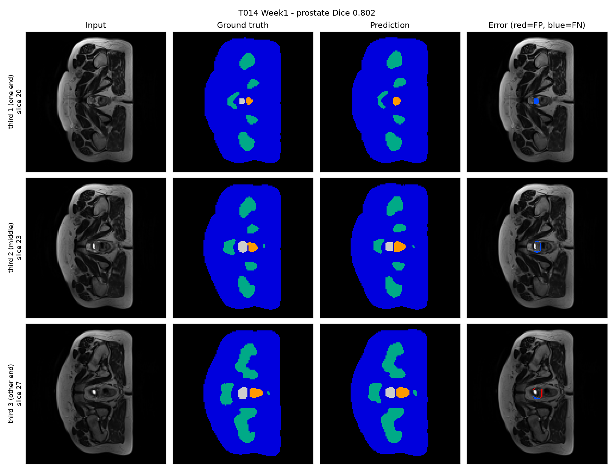

**T014_Week2** — improved (up) and baseline (down) predictions


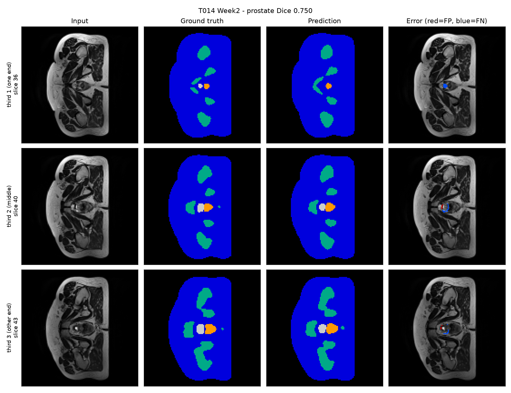

**J026_Week6** — improved (up) and baseline (down) predictions

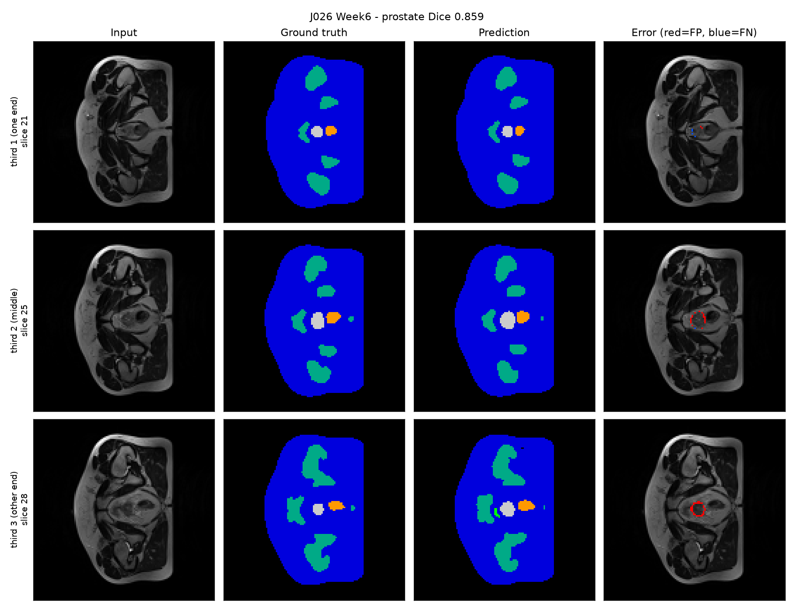


**J026_Week7** — improved (up) and baseline (down) predictions

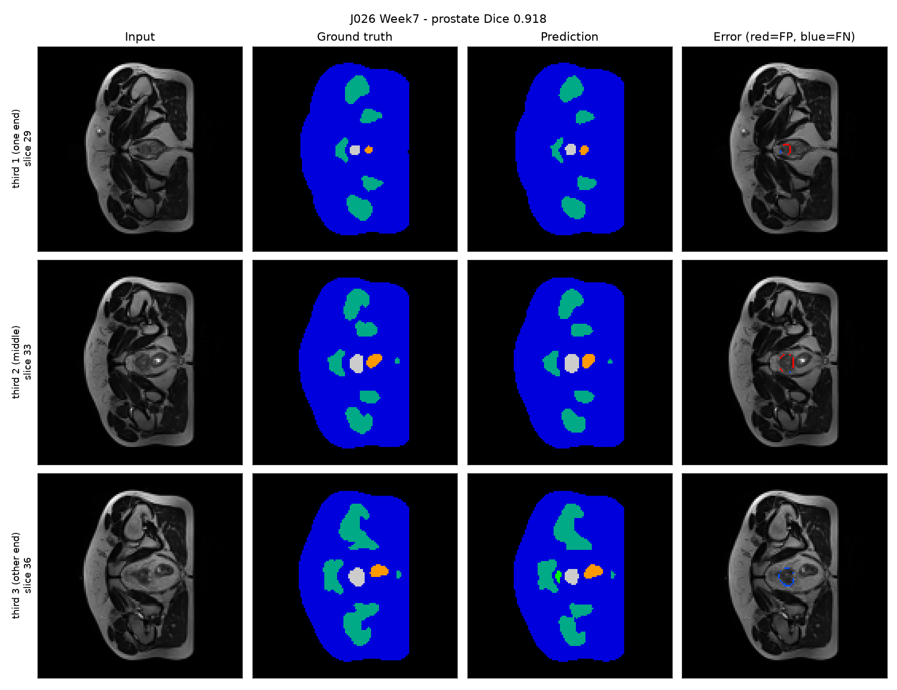


---

## 8. Discussion and recommendation

**Does the improved model remove the boundary and slice-transition errors?** 

No, but it reduces them where they matter most. Against the 3D U-Net baseline, the improved model's gain in prostate Dice is largest at the weakest end of the gland (+0.055 in the first third, compared with +0.014 in the middle) and it clearly improves the rectum (Dice 0.857 vs 0.811) and the bladder boundary (HD95 1.19 vs 3.06 voxels). Overall prostate Dice and prostate boundary distance are almost the same for the two models (0.853 vs 0.846, HD95 1.47 vs 1.42). So the improvement is not a smoothing of the easy middle slices but the weak end remains clearly the hardest region for both and a few volumes (for example `J026_Week7` for the rectum) still show large boundary errors.

**Is the added cost justified?** 

The extra cost is modest which is about 1.5× the parameters, 1.6× the training memory and 1.3× the inference time (0.022 s per volume) although total training time was not measured. The benefit is concentrated in the rectum, the bladder boundary and the weakest end of the prostate which are the places where errors cause the most clinical harm while the global prostate Dice gain is small and statistically uncertain (p = 0.077). For a drafting assistant I would argue the extra cost is acceptable but this rests on one training run per model and a six-patient test set and part of the gain may come from the larger model size or from the different normalisation layers (instance norm versus batch norm at batch size 1).

**Cases unsuitable for automated drafting:** 

Three situations still need careful manual review or full manual contouring: 

(1) The small end of the gland where the prostate cross-section is only a few voxels wide and both models miss or nearly miss it (first-third prostate Dice 0.787 for the improved model and 0.732 for the baseline, against 0.909 and 0.895 in the middle. For example `T014_Week1` and `T014_Week2`)

(2) The prostate–rectum interface where the improved model's contour extended towards the rectum in `J026_Week1` (prostate Dice 0.775) and over-segmented the rectum in `J026_Week7` (rectum Dice 0.647, HD95 7.3 voxels) and `J026_Week6` (rectum HD95 8.5 voxels) 

(3) The end of the gland next to the bladder where small false-positive bladder labels appear beside the prostate.

**Recommendation to the project manager.** 

The Improved 3D U-Net is worth using over the plain 3D U-Net as a drafting assistant, because it improves the rectum (Dice 0.857 vs 0.811), the bladder boundary (HD95 1.19 vs 3.06 voxels) and the weakest end of the prostate (+0.055 Dice) at a modest cost (about 1.5× the parameters and 1.3× the inference time of the baseline, 0.022 s per volume). It should not be used unattended: the gain in overall prostate Dice is small and statistically uncertain (+0.007, p = 0.077), and individual volumes show over-contouring into the rectum, which is the clinically harmful direction. A specialist should review every slice at both ends of the gland and along the prostate–rectum interface. These conclusions rest on one training run per model and a six-patient test set, so they should be confirmed on more patients and with repeated seeds before any operational decision.

**Limitations.**
- Only 6 test patients, and three of them contribute 24 of the 27 test volumes so the effective sample size is small and per-patient variation (prostate Dice from 0.81 to 0.91 across patients) matters.
- Each model is a single training run; no seeds were repeated.
- Distances are measured in voxels of the resized volume, not millimetres.
- The comparison is against a 3D baseline so it measures the benefit of the improved architecture, not of 3D versus 2D context. A 2D U-Net comparison would be a natural extension.
- Mild overfitting (train loss 0.053 vs. validation loss 0.113).

---

## 9. Artificial Intelligence Usage Disclosure

**Tools used:** Claude.

**What it assisted with:** Debugging of `modules.py`, `dataset.py`, `utils.py`, `train.py`, `predict.py` and `compare.py`; Slurm batch scripts and Rangpur debugging. Proofreading my README

**How I verified it:** I ran a smoke test before full training to check if the code works, check the output and verify if it is accurate.

---

## 10. References

1. F. Isensee et al., "Brain tumor segmentation and radiomics survival prediction: Contribution to the BRATS 2017 challenge," in Brainlesion, 2018, pp. 287–297.
2. Ö. Çiçek et al., "3D U-Net: Learning dense volumetric segmentation from sparse annotation," in MICCAI, 2016, pp. 424–432.
3. HipMRI Study dataset, as provided by the COMP3710 teaching team.
